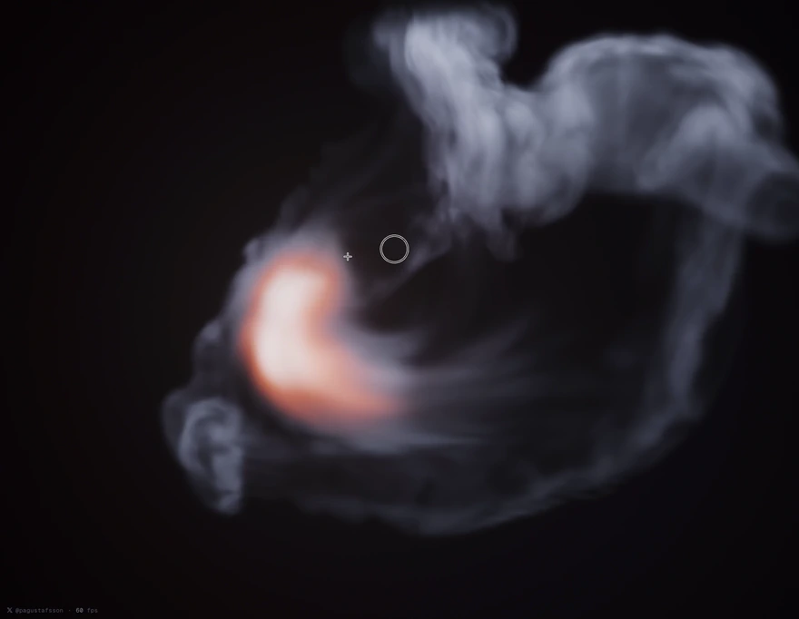

# Krakatoa Smoke

[](https://pagustafsson.github.io/krakatoa/media/krakatoa.mp4)

Glowing, colourful smoke in real time that follows your pointer while you hold the mouse button down. There are two effects: **Lava**, millions of fine particles carried by a 2D fluid, and **Smoke**, a real 3D smoke simulation that is ray-marched every frame. Everything lives in a single HTML file written in plain WebGL2, with no libraries and no build step.

**[Try it live](https://pagustafsson.github.io/krakatoa/)**: [Smoke](https://pagustafsson.github.io/krakatoa/#smoke) · [Lava](https://pagustafsson.github.io/krakatoa/#lava) · **[Watch the video](https://pagustafsson.github.io/krakatoa/media/krakatoa.mp4)** (37 s)

Created by [@pagustafsson](https://x.com/pagustafsson) with Claude Opus 5.5 by Anthropic.

If you like Krakatoa, here is a way to show your appreciation: [buy me a coffee](https://buymeacoffee.com/pagustafsson) ☕

## Getting started

1. Open `index.html` in a current version of Chrome, Safari, Edge or Firefox.
2. Hold down the mouse button and drag. On phones and tablets, use your finger. Several fingers at once work too.

If your browser won't run the page straight from disk, start a local server in the project folder and go to `http://localhost:8000`:

```bash
python3 -m http.server 8000
```

## Effects

- **Lava**: millions of fine particles that glow together, with strands and veils of smoke.
- **Smoke**: smoke in three dimensions. The gas at the brush is hot and glows. It rises on its own, cools, and turns into smoke that swirls, shades itself and is lit by the glow.

Switch effect with the **Effect** buttons at the top of the panel, or press **M**. Your choice is remembered for the next visit.

To open a specific effect directly, add `#lava` or `#smoke` to the end of the address. The older links `#partiklar` and `#volym` still work.

Each effect only simulates its own smoke, so the other one stays frozen until you switch back. **Clear** (C) empties both. The palette swatches show the colours of the effect you are in.

## Settings

**Each effect has its own settings**: every slider, the palette, the quality, and the switches Smoke field, Particles and Light follows pointer. When you switch effect, the panel shows the other effect's settings. Settings are saved in your browser and survive a reload.

**Shared settings**: the chosen effect, Autopilot and whether the panel is open are shared by both effects and saved when you change them. Pause is never saved.

**Reset**: the **Reset Lava settings** or **Reset Smoke settings** button at the bottom of the panel restores the defaults of the effect you are in. The other effect is not touched.

**First visit**:

- The page opens in **Smoke** with the **Ash** palette, **Ultra** quality and a 4 % brush, unless the link ends in `#lava`. Lava starts with **Aurora** and **High** quality. On phones and tablets both effects start at **Medium**.
- **Autopilot** paints smoke on its own until you click or touch the drawing area. Every click on the drawing area stops it, so you can paint your own smoke. Stopping it this way is not remembered, so it runs again on your next visit. Turning it off with the Autopilot switch or the **A** key is remembered.

If the browser blocks storage, for example in a private window, everything still works, but settings are forgotten when the page reloads.

## Controls

| Key | Action |
| --- | --- |
| Space | Pause and resume |
| C | Clear the smoke |
| H | Show or hide the settings panel |
| A | Turn Autopilot on or off |
| M | Switch between Lava and Smoke |
| 1–5 | Palette: Ash, Aurora, Nebula, Magma, Spectrum |

The panel has these groups:

- **Quality**: see the table below.
- **Brush**: Size, Amount and Force.
- **Flow**: Swirl, Turbulence and Lifetime.
- **Light and rendering**: Smoke field, Particle density, Light, Shadows and Glow.
- **Heat** (Smoke only): **Cooling** sets how fast the hot gas cools. Short gives a small glowing flame, long lets the gas glow and rise further. **Lift** sets how strongly hot gas rises, from 0 to 3 times normal.
- **Layers**: Smoke field, Particles, Light follows pointer and Autopilot.

The Smoke field and Particle density sliders and the Smoke field and Particles switches only apply to Lava and are hidden in Smoke. In Smoke, **Lifetime** shows roughly how many seconds the smoke stays visible after it leaves the brush, from about 2 to 7.5 seconds.

**Quality** sets the number of particles in Lava and the size of the 3D grid in Smoke. The defaults are Ultra for Smoke and High for Lava on computers, and Medium on touch devices. The Smoke grid follows the shape of the window, and in Smoke the Quality menu shows the grid each level gives in the current window. In a 1920 × 1080 window:

| Quality | Lava particles | Smoke grid |
| --- | --- | --- |
| Low | 262,144 | 100 × 56 × 36 |
| Medium | 1,048,576 | 136 × 76 × 52 |
| High | 2,097,152 | 200 × 112 × 76 |
| Ultra | 4,194,304 | 228 × 128 × 84 |

The **i** button at the top of the settings panel opens this guide. The bottom-left corner shows a link to the creator on X and the current frame rate.

## How it works

### Lava

1. **Fluid.** A 2D fluid solver on the GPU in the style of Stam's *Stable Fluids*, with vorticity confinement (Swirl) and curl-noise turbulence. Brush strokes are added as soft Gaussian strokes along the pointer's path, so fast strokes leave no gaps.
2. **Particles.** Particle positions are stored in a floating-point texture and moved by the fluid's velocity, plus finer curl noise for thin strands. New particles are born from a ring buffer along the stroke.
3. **Colour.** Smoke is born in a hot colour that shifts while you draw, then cools toward the palette's cool colour.
4. **Light.** A light at the pointer casts shadows through the smoke by marching toward it across the screen. The smoke's density gives it shaded, rounded surfaces, and a faint key light from above lights the rest.

### Smoke

1. **A 3D grid.** The smoke lives in a box behind the screen, divided into 56 to 128 cells along the screen's short side depending on quality, and two thirds as many in depth. Each depth slice is a tile in one large 2D texture, so every solver step is a single draw call.
2. **Moving the smoke.** Density, temperature and freshness (how new the smoke is) are carried along by the flow with the MacCormack method, which keeps sharper detail than the simpler semi-Lagrangian method. When no brush is active, the total amount of smoke is never allowed to grow. The sides of the box are open, so smoke that leaves it disappears.
3. **Forces.** Hot gas rises (Lift), vorticity confinement keeps the curls alive where there is smoke (Swirl), and a soft, drifting turbulence field keeps it moving (Turbulence). The brush heats the gas, adds smoke and drags the gas in the direction you move.
4. **Pressure.** Air can't be squeezed, so 16 to 30 Jacobi iterations per frame adjust the flow until as much air leaves each cell as enters it. This is what makes the smoke billow and roll over itself.
5. **Light.** A half-resolution light volume works out how much light reaches each point, from a glow-coloured light at the pointer and from a key light above, with shadows through the smoke.
6. **Ray marching.** A lower-resolution image sends one ray per pixel through the box. The smoke blocks light from behind, scatters the light from the light volume toward the camera, and glows where it is hot. The image is then smoothly scaled up to the screen.
7. **Detail finer than the grid.** In large, cooled clouds, the smoke is displaced by noise that is carried along by the flow, so the fine detail stretches and swirls with the smoke. The noise restarts regularly before it stretches too far. The hot flame and fast jets get no noise.

Both effects finish the same way: an HDR image with glow, ACES filmic tone mapping, a vignette and dithering.

### Automatic quality

When Smoke's frame rate stays too low, it switches to a coarser grid one step at a time, carries the smoke over, and the Quality heading shows "lowered to …". A step that doesn't raise the frame rate, for example because the browser caps the page at 30 frames per second, is undone, and when there is room again Smoke steps back up toward the quality you chose. Lava never changes quality on its own.

## Requirements

- WebGL2 with the `EXT_color_buffer_float` extension. All modern desktop browsers have it, and so does Safari on iOS 15 and later.
- Smoke also needs to render to floating-point 3D textures. If the graphics driver can't, the Smoke button is disabled and the page shows Lava.
- The fonts come from Google Fonts. Without them, the page uses system fonts.

## Size

One file, `index.html`: about 121 KB, or about 38 KB gzipped.

## Credits and references

- Jos Stam, *Stable Fluids* (SIGGRAPH 1999): semi-Lagrangian advection and pressure projection, the base of both solvers.
- Ronald Fedkiw, Jos Stam and Henrik Wann Jensen, *Visual Simulation of Smoke* (SIGGRAPH 2001): vorticity confinement, used by Swirl in both effects.
- Andrew Selle, Ronald Fedkiw, ByungMoon Kim, Yingjie Liu and Jarek Rossignac, *An Unconditionally Stable MacCormack Method* (Journal of Scientific Computing, 2008): the limited MacCormack advection in Smoke.
- Mark Harris, *Fast Fluid Dynamics Simulation on the GPU* (GPU Gems, 2004), and Keenan Crane, Ignacio Llamas and Sarah Tariq, *Real-Time Simulation and Rendering of 3D Fluids* (GPU Gems 3, 2007): fluid solvers in fragment shaders, and 3D grids stored as flat 2D textures.
- Robert Bridson, Jim Hourihan and Marcus Nordenstam, *Curl-Noise for Procedural Fluid Flow* (SIGGRAPH 2007): the turbulence and particle strands in Lava, and the detail noise in Smoke.
- Theodore Kim, Nils Thürey, Doug James and Markus Gross, *Wavelet Turbulence for Fluid Simulation* (SIGGRAPH 2008): the idea behind Smoke's detail finer than the grid, noise carried by the flow and renewed before it stretches too far. Krakatoa uses curl noise instead of wavelet noise.
- Pavel Dobryakov, [WebGL Fluid Simulation](https://github.com/PavelDoGreat/WebGL-Fluid-Simulation) (MIT license): the Lava solver follows its structure.
- Inigo Quilez: gradient noise with analytic derivatives, the base of the curl noise in Lava.
- Krzysztof Narkowicz, *ACES Filmic Tone Mapping Curve* (2016): the tone-mapping fit used by both effects.
- The Krakatoa particle renderer by Thinkbox Software: the visual inspiration, and the name.

## License

MIT, see [LICENSE](LICENSE). Keep the copyright notice when you use or share the code. A mention of [@pagustafsson](https://x.com/pagustafsson) and the name Krakatoa is appreciated.
